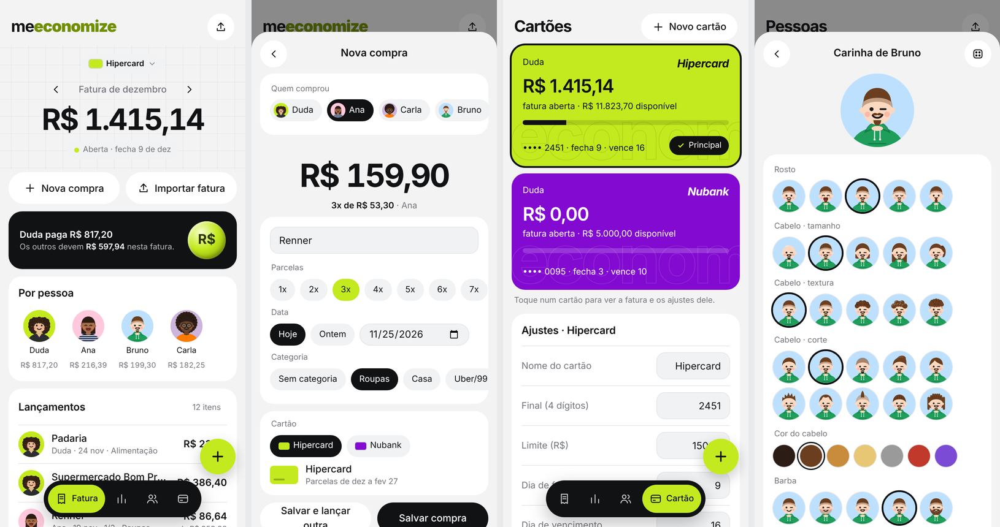

# Me Economize

**Controle da fatura do cartão de crédito, mês a mês e por pessoa, sem burocracia.**

Feito para quem divide o cartão com a família ou com amigos e precisa saber, em cada fatura, quanto é seu e quanto cada pessoa deve. É um app web leve, que funciona offline e pode ser instalado no celular como um aplicativo.



<sub>As telas usam dados fictícios.</sub>

## O que ele faz

- **Fatura mês a mês.** Mostra o total da fatura, se ela está aberta, fechada ou futura, e quando fecha e vence. Use as setas para ver os outros meses.
- **Quanto cada pessoa deve.** Separa o que é seu e o que é dos outros. Toque numa pessoa para ver só as compras dela.
- **Lançamento rápido.** Valor, quem comprou e parcelas em poucos toques. A categoria é sugerida pelo nome da loja e é opcional. O botão "Salvar e lançar outra" agiliza vários lançamentos seguidos.
- **Importar a fatura sem duplicar.** Aceita o PDF da fatura ou o texto copiado dela. O app compara cada linha com o que já foi registrado e só adiciona o que falta, então você pode importar a mesma fatura quantas vezes quiser.
- **Parcelas no lugar certo.** Cada parcela cai na fatura correta, de acordo com o dia de fechamento do cartão.
- **Visão por meses.** Mostra o histórico das faturas e quanto já está comprometido nos próximos meses.
- **Vários cartões, ou só um.** Com um cartão só, o app nunca pergunta qual usar. Com mais de um, cada cartão tem sua fatura, seus dias de fechamento e vencimento e sua cor.
- **Pessoas organizadas.** Quem não tem mais parcelas a vencer nem compras recentes sai das listas sozinho. Dá para arquivar, renomear e juntar nomes duplicados.
- **Carinhas personalizadas.** Monte um avatar para cada pessoa: rosto, cabelo (tamanho, textura e corte), barba, pele, blusa e acessórios.
- **Backup.** Exporta e importa um arquivo `.json`, compatível com o backup do app antigo (Me Economize, feito no Lovable).
- **Modo claro e escuro**, conforme o sistema.

## Como usar

1. Abra o app. Na primeira vez, importe um backup ou comece do zero.
2. Em **Cartão**, ajuste o nome, o limite e os dias de fechamento e vencimento.
3. Lance compras pelo botão **+** ou importe a fatura em **Importar fatura**.
4. Faça um backup de vez em quando em **Cartão → Exportar backup**.

## Instalar no celular

- **iPhone (Safari):** abra o endereço, toque em **Compartilhar** e depois em **Adicionar à Tela de Início**.
- **Android (Chrome):** abra o endereço, toque no menu **⋮** e depois em **Instalar app**.

Depois de instalado, o app abre em tela cheia e funciona sem internet.

## Privacidade

Seus dados **nunca saem do seu aparelho**. Eles ficam salvos no navegador onde você usa o app, sem servidor, sem conta e sem rastreamento. Por isso:

- cada aparelho ou navegador tem seus próprios dados;
- para levar os dados para outro aparelho, use **Exportar backup** e **Importar backup**;
- limpar os dados do navegador apaga as informações do app, então mantenha um backup.

## Publicar no GitHub Pages

1. Crie um repositório e envie **todos** os arquivos desta pasta, incluindo `icons/` e `docs/`.
2. Em **Settings → Pages**, escolha **Deploy from a branch**, branch `main` e pasta `/ (root)`, e salve.
3. Em 1 a 2 minutos o endereço aparece na mesma página, por exemplo `https://seuusuario.github.io/me-economize/`.

## Estrutura

```
index.html            o app inteiro (HTML, CSS e JavaScript num arquivo só)
manifest.webmanifest  nome, cores e ícones para instalar como app
sw.js                 service worker: funcionamento offline e atualização
icons/                ícones do app
docs/                 imagens deste README
```

Não há etapa de build nem dependências para instalar. A fonte vem do Google Fonts e o leitor de PDF (pdf.js) do cdnjs. Os dois só são carregados quando necessários e ficam guardados para uso offline.

## Atualizar

Substitua o `index.html` no repositório. Se alterar outros arquivos, aumente `VERSAO` no `sw.js` (por exemplo, para `v2`), para os aparelhos baixarem a versão nova.

## Limitações conhecidas

- A leitura do PDF depende do layout de cada banco. Se alguma fatura não for lida, copie o texto dela e use a opção **Colar texto**.
- Os dados não sincronizam sozinhos entre aparelhos. Use o backup.
